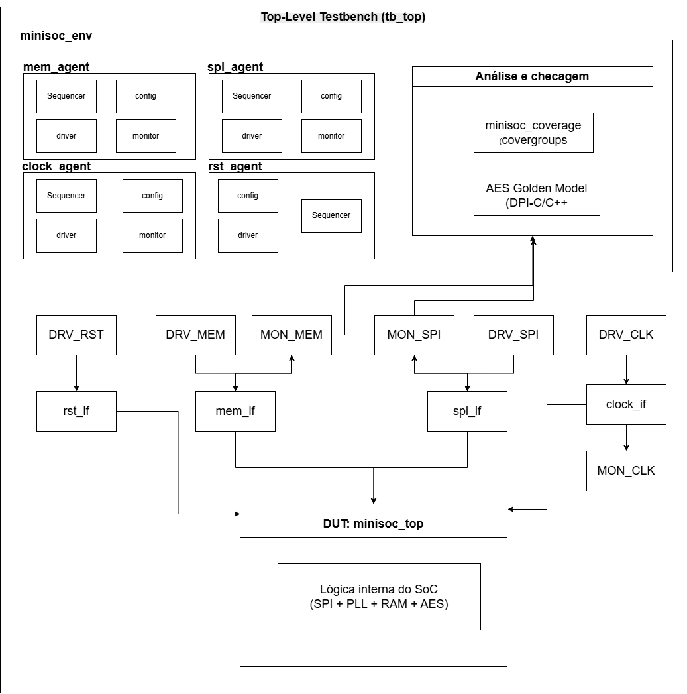

# Project_AESminiSoC — Design Verification (UVM)
Repositório dedicado ao desenvolvimento, arquitetura e execução do ambiente de **Design Verification (DV)** para o **MiniSoC AES**, desenvolvido no âmbito do programa de **Residência em Microeletrônica (CI-Expert — Polo UFCG)**.
---
## 📢 Atualizações Recentes
Prezado professor/avaliador, os seguintes artefatos, códigos e infraestruturas de teste foram integrados e estão disponíveis no repositório:
1. **Infraestrutura de Bring-up & Smoke Test UVM Concluída (`minisoc_smoke_test`)**:
   * **`clock_agent` Completo**:
     * Geração contínua e parametrizada dos dois domínios externos do SoC: referência de **2 GHz** (`clk`) e barramento de memória de **100 MHz** (`mem_clk`).
     * Composto por: `clock_if.sv`, `clock_item.sv`, `clock_agent_config.sv`, `clock_driver.sv`, `clock_monitor.sv`, `clock_sequencer.sv` e `clock_pkg.sv`.
   * **`rst_agent` Completo**:
     * Geração e controle de reset global determinístico ativo em nível baixo (`rst_n`).
     * Composto por: `rst_if.sv`, `rst_item.sv`, `rst_agent_config.sv`, `rst_driver.sv`, `rst_sequencer.sv` e `rst_pkg.sv`.
   * **Sequenciamento UVM (`minisoc_reset_seq.sv`)**:
     * Sequence responsável por orquestrar a aplicação do pulso de reset (25 ns) e sua liberação coordenada com as bordas de clock.
   * **Environment Integrado (`minisoc_env.sv`)**:
     * `uvm_env` integrando ativamente o `clock_agent` e o `rst_agent`.
   * **Suíte de Testes Inicial (`minisoc_base_test.sv` e `minisoc_smoke_test.sv`)**:
     * Execução com sucesso do *Smoke Test*, validando a estabilização do clock de 2 GHz, liberação limpa do reset (`rst_n = 1`) e integridade dos tie-offs de hardware no `top_tb.sv`.
2. **Diagrama de Arquitetura do Testbench (`tb_architecture.png`)**:
   * Diagrama esquemático completo exibindo a topologia do testbench UVM, suas interfaces virtuais e camadas de checagem.
   * Localização: Raiz do repositório (`/tb_architecture.png`).
3. **Plano de Verificação Preenchido (`Verification Plan`)**:
   * Mapeamento formal de requisitos, cenários direcionados, testes de injeção de erro, cenários DITL (*Day In The Life*) e modelo de *Cross Coverage*.
   * **Arquivo principal**: `CI-Expert_Fase2_Verification_Plan.docx` (e respectivo backup).
   * Localização: `AULA10_Project_AESminiSoC/Deliverables/`
---
## 🏛️ Arquitetura do Ambiente de Verificação (UVM)
Abaixo está a representação estrutural da topologia desenvolvida para verificação do DUT (`minisoc_top`):

### Estrutura dos Componentes UVM:
* **Clock Agent (`clk_agt`)**: Alimenta com precisão os dois domínios de clock concorrentes (`clk` de 2 GHz e `mem_clk` de 100 MHz) com monitoramento ativo via `clock_monitor`.
* **Reset Agent (`rst_agt`)**: Aplica o sequenciamento de reset global e permite a injeção de *warm resets* durante testes avançados.
* **Top Environment (`minisoc_env`)**: Agrupa os agentes de protocolo e conecta os canais de comunicação com a camada de análise.
* **Testes & Sequências**: Testes estruturados hierarquicamente a partir de `minisoc_base_test`, com sequências orquestradas para estímulos controlados.
---
## 🔍 Sobre o DUT (MiniSoC AES)
O **MiniSoC AES** é um micro-SoC digital projetado para acelerar operações de criptografia e decriptação simétrica baseadas no algoritmo **AES-128** (NIST FIPS 197):
* **Separação de Planos**: Plano de controle seriais via SPI (4 fios, $\le 25\text{ MHz}$) e plano de dados em alta velocidade via interface paralela de memória (32 bits, 100 MHz).
* **SPI Front-End (`minisoc_spi`)**: Banco de registradores com operação em domínio *always-on* (2 GHz) e intertravamento de escrita em hardware durante `AES_BUSY`.
* **PLL RTL Mock (`minisoc_pll_mock`)**: Divisores programáveis (/1, /2, /4 e /8) com modelo de atraso de *lock* via LFSR e liberação de clock livre de *glitches*.
* **Memória Compartilhada (`minisoc_memory`)**: SRAM síncrona single-port de 1024 palavras $\times$ 32 bits (4 KB) operando sob exclusão mútua (`MEM_SEL_AES`).
* **AES Engine (`minisoc_aes`)**: Datapath com processamento *in-place* de até 256 blocos nos modos ECB, CBC, PCBC, CFB, OFB e CTR.
---
## 📁 Estrutura do Repositório
```text
Project_AESminiSoC/
├── README.md                                  # Documentação principal do projeto
├── tb_architecture.png                        # Diagrama da arquitetura do Testbench UVM
└── AULA10_Project_AESminiSoC/
    ├── Deliverables/                          # Documentação formal e entregáveis
    │   ├── CI-Expert_Fase2_Verification_Plan.docx        # Plano de verificação preenchido
    │   ├── CI-Expert_Fase2_Verification_Plan_BACKUP.docx # Backup do plano
    │   └── ...
    ├── DV_BlockGuide_MiniSoCAES_v1.0.0.pdf   # Guia e especificação de blocos do SoC
    └── minisoc-tag-v1.0.0/                    # Código-fonte
        └── minisoc-tag-v1.0/
            ├── frontend/rtl/                  # RTL do DUT (minisoc_top, aes, spi, pll, mem)
            └── verif/tb/                      # Ambiente de Verificação UVM
                ├── agents/                    # Agentes UVM
                │   ├── clock_agent/           # Agente de Clock UVM
                │   │   ├── clock_if.sv        # Interface física (2 GHz e 100 MHz)
                │   │   ├── clock_item.sv      # Transação de clock (uvm_sequence_item)
                │   │   ├── clock_agent_config.sv # Configuração do agente (Active/Passive)
                │   │   ├── clock_driver.sv    # Driver de oscilação contínua dos clocks
                │   │   ├── clock_monitor.sv   # Monitor de verificação de período ($realtime)
                │   │   ├── clock_sequencer.sv # Sequencer de clock
                │   │   └── clock_pkg.sv       # Package do clock_agent
                │   └── rst_agent/             # Agente de Reset UVM
                │       ├── rst_if.sv          # Interface física de reset (rst_n)
                │       ├── rst_item.sv        # Transação de reset
                │       ├── rst_agent_config.sv# Configuração do rst_agent
                │       ├── rst_driver.sv      # Driver de acionamento do reset
                │       ├── rst_sequencer.sv   # Sequencer de reset
                │       └── rst_pkg.sv         # Package do rst_agent
                ├── env/                       # Environment UVM
                │   ├── minisoc_env.sv         # Instanciação e amarração dos agentes
                │   └── env_pkg.sv             # Package do environment
                ├── sequences/                 # Biblioteca de Sequências UVM
                │   ├── minisoc_reset_seq.sv   # Sequência de inicialização e pulso de reset
                │   └── seq_pkg.sv             # Package de sequências
                ├── tests/                     # Suíte de Testes UVM
                │   ├── minisoc_base_test.sv   # Teste base com configuração de infraestrutura
                │   ├── minisoc_smoke_test.sv  # Smoke test de validação de Clock & Reset
                │   └── test_pkg.sv            # Package de testes
                ├── refmod/                    # Golden Model C/C++ (DPI-C)
                ├── top_assertions.sv          # Asserções SVA de protocolo
                ├── top_tb.sv                  # Top-level de simulação UVM com tie-offs
                └── Makefile                   # Scripts de compilação e execução
