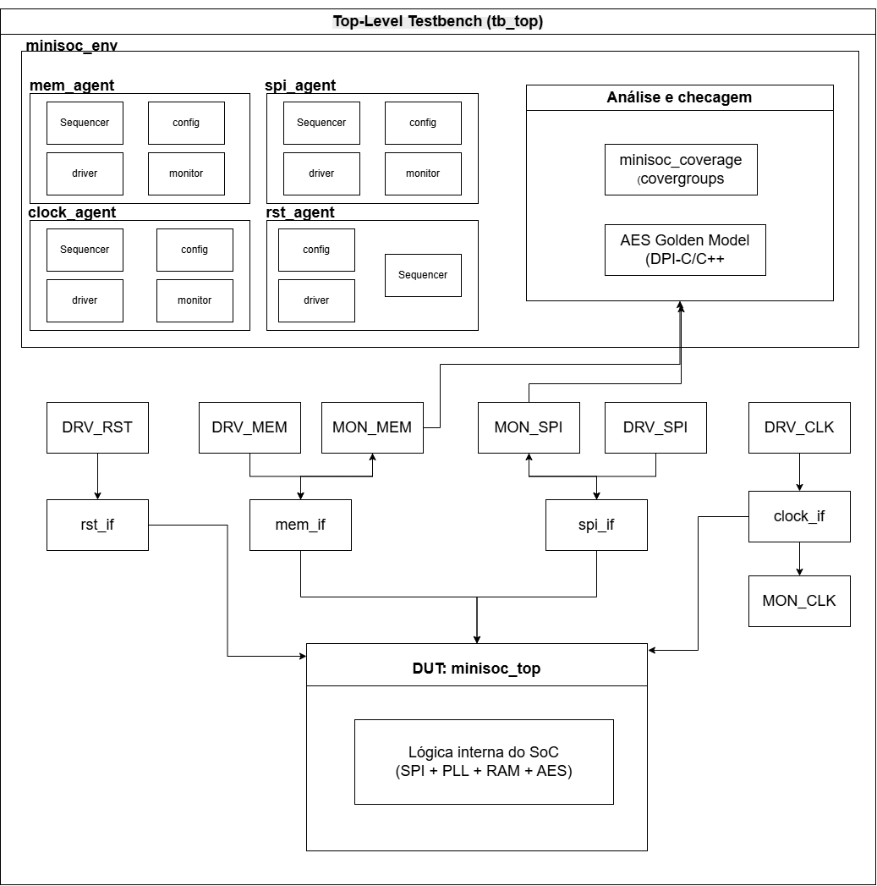

# Project_AESminiSoC — Design Verification (UVM)

## 📢 Atualizações Recentes (Destaques para Avaliação)
Os seguintes artefatos, entregáveis e desenvolvimentos de código foram atualizados no repositório:
1. **Diagrama de Arquitetura do Testbench (`tb_architecture.png`)**:
   * Diagrama completo ilustrando a topologia do ambiente **UVM (Universal Verification Methodology)**.
   * Apresenta a estruturação dos agentes de verificação (`clk_agent`, `rst_agent`, `spi_agent`, `mem_agent`), conexões via interfaces virtuais (`virtual interfaces`), modelo de referência em C/C++ via DPI-C e o Scoreboard.
   * Localização: Raiz do repositório (`/tb_architecture.png`).
2. **Plano de Verificação Preenchido (`Verification Plan`)**:
   * Documento formal de especificação do plano de teste contendo mapeamento de requisitos, funcionalidades a verificar, definição dos cenários de teste, métricas de cobertura (código e funcional) e matriz de rastreabilidade.
   * **Arquivo principal**: `CI-Expert_Fase2_Verification_Plan.docx`
   * **Cópia de segurança**: `CI-Expert_Fase2_Verification_Plan_BACKUP.docx`
   * Localização: `AULA10_Project_AESminiSoC/Deliverables/`
3. **Implementação do Agente de Clock (`clock_agent`)**:
   * Estruturação inicial do agente UVM responsável por gerar e coordenar os domínios de clock do sistema:
     * **`clock_if.sv`**: Interface física do SystemVerilog contendo as definições dos clocks do SoC — a referência de **2 GHz** (`clk`) e o clock externo da memória de **100 MHz** (`mem_clk`).
     * **`clock_item.sv`**: Classe de transação UVM (`uvm_sequence_item`) para parametrização dos períodos, frequências e ciclo de trabalho (*duty cycle*).
     * **`clock_driver.sv`**: Driver UVM (`uvm_driver`) responsável por receber as configurações e oscilar fisicamente os pinos da interface virtual (`vif.clk` e `vif.mem_clk`).
   * Localização: `.../verif/tb/agents/clock_agent/`
---
## 🏛️ Arquitetura do Ambiente de Verificação (UVM)
Abaixo está a representação estrutural do testbench desenvolvido para validação do DUT (`minisoc_top`):

### Principais Componentes do Testbench:
* **Clock Agent (`clk_agent`)**: Responsável por alimentar com precisão os dois domínios de clock concorrentes do sistema (`clk` de 2 GHz e `mem_clk` de 100 MHz).
* **Reset Agent (`rst_agent`)**: Gera e controla o sequenciamento de reset global ativo em nível baixo (`rst_n`).
* **SPI UVM Agent (Master)**: Responsável por enviar estímulos seriais ao front-end SPI (Modo 0, 40 bits), programando chaves, IV, modos e monitorando registradores de status via *polling*.
* **Memory UVM Agent**: Gerencia as operações de escrita de texto claro (*plain text*) e leitura de texto cifrado (*cipher text*) na interface `MEMORY DATA`.
* **Reference Model (Predictor)**: Implementação *golden model* do algoritmo AES-128 integrada via SystemVerilog DPI-C para previsão dos dados esperados.
* **Scoreboard**: Comparação ciclo a ciclo e transação por transação entre o resultado produzido pelo hardware e o modelo de referência.
---
## 🔍 Sobre o DUT (MiniSoC AES)
O **MiniSoC AES** é um sistema digital projetado para acelerar operações de criptografia e decriptação simétrica baseadas no algoritmo **AES-128** (NIST FIPS 197), composto por quatro blocos fundamentais:
* **SPI Front-End (`minisoc_spi`)**: Interface serial e banco de registradores para controle, configuração e telemetria (sempre alimentado pelo clock *always-on* de 2 GHz).
* **PLL RTL Mock (`minisoc_pll_mock`)**: Sintetizador/divisor de clock dinâmico com suporte a frequências de 250 MHz a 2 GHz e emulação de tempo de *lock*.
* **AES Engine (`minisoc_aes`)**: Datapath com suporte a processamento de 1 a 256 blocos *in-place* e compatibilidade com 6 modos de cifra (**ECB, CBC, PCBC, CFB, OFB e CTR**).
* **Memória Compartilhada (`minisoc_memory`)**: SRAM síncrona single-port de 1024 palavras de 32 bits (4 KB) com arbitragem entre o usuário externo e o motor AES.
---
## 📂 Estrutura do Repositório
```text
Project_AESminiSoC/
├── README.md                                  # Documentação principal
├── tb_architecture.png                        # Diagrama da arquitetura do Testbench UVM
└── AULA10_Project_AESminiSoC/
    ├── Deliverables/                          # Documentação e Entregáveis
    │   ├── CI-Expert_Fase2_Verification_Plan.docx        # Plano de verificação preenchido
    │   ├── CI-Expert_Fase2_Verification_Plan_BACKUP.docx # Backup do plano
    │   └── ...
    ├── DV_BlockGuide_MiniSoCAES_v1.0.0.pdf   # Guia e especificação de blocos do SoC
    └── minisoc-tag-v1.0.0/                    # Código-fonte
        └── minisoc-tag-v1.0/
            ├── frontend/rtl/                  # RTL do DUT (minisoc_top, aes, spi, pll, mem)
            └── verif/tb/                      # Ambiente UVM
                ├── agents/
                │   └── clock_agent/           # Agente de Clock UVM
                │       ├── clock_if.sv        # Interface física de clocks (2 GHz e 100 MHz)
                │       ├── clock_item.sv      # Transação de clock (uvm_sequence_item)
                │       └── clock_driver.sv    # Driver de clock (uvm_driver)
                ├── env/                       # Environment UVM
                ├── refmod/                    # Modelo de referência C/C++ (DPI-C)
                ├── tests/                     # Casos e sequências de teste
                └── top_tb.sv                  # Top-level de simulação
